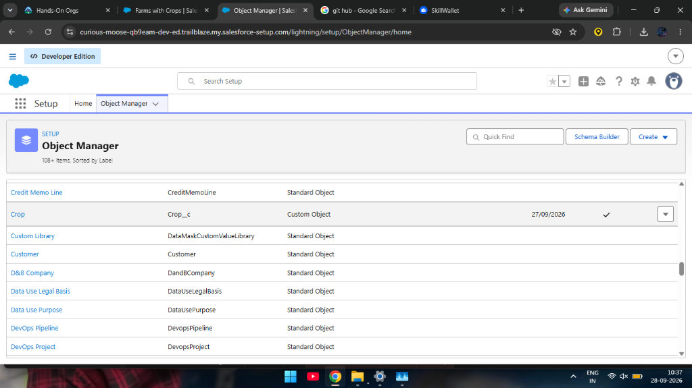
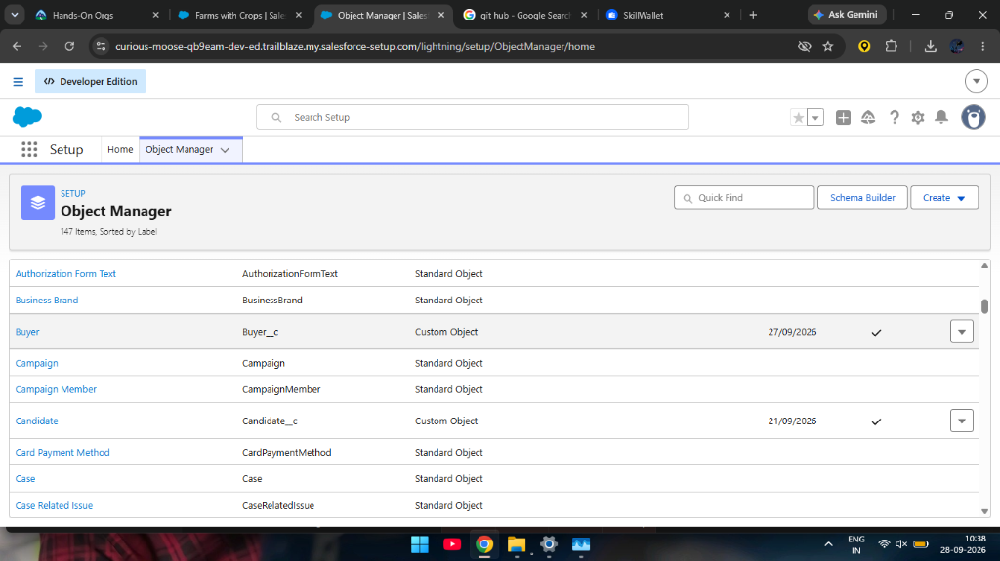
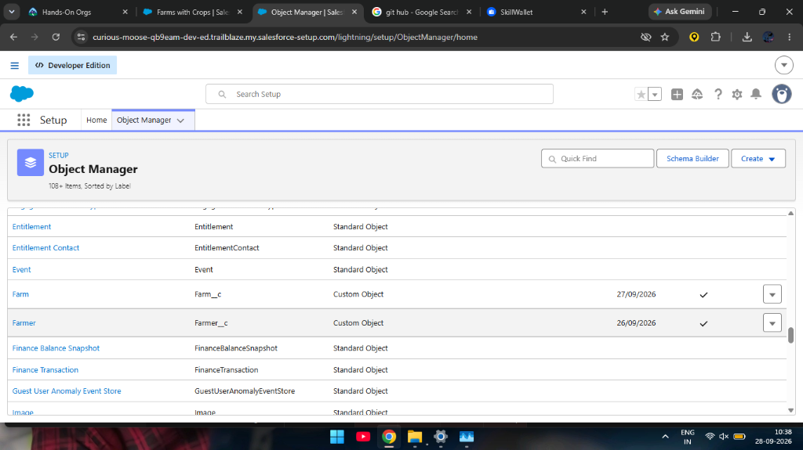
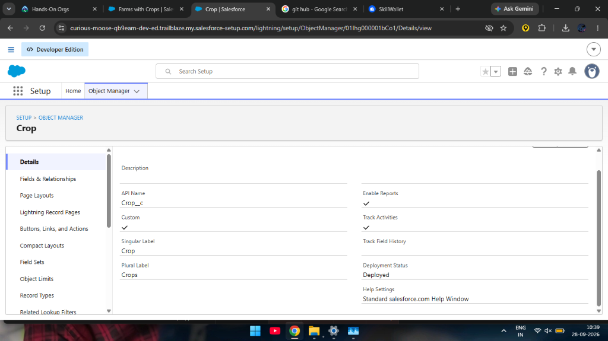
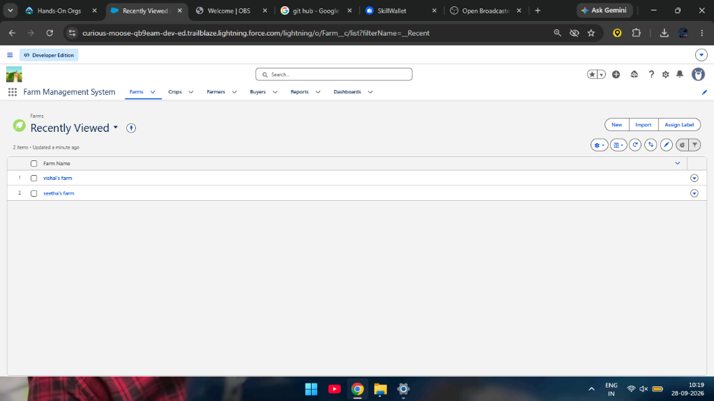
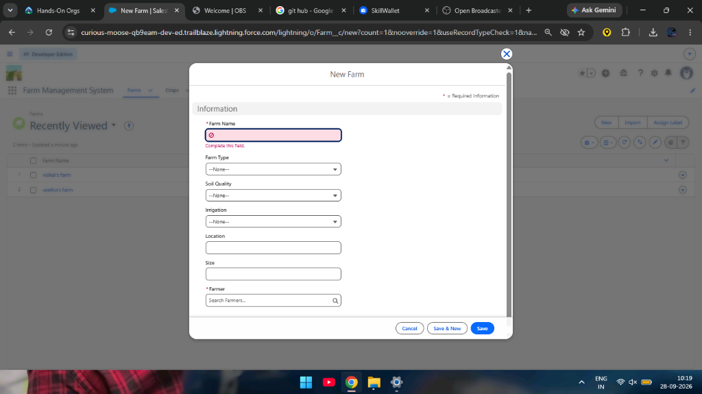
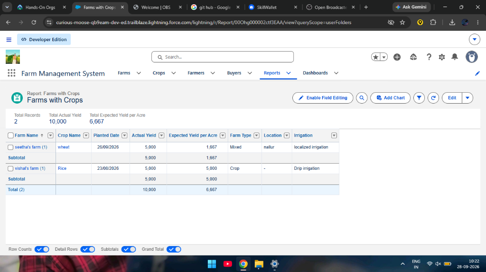
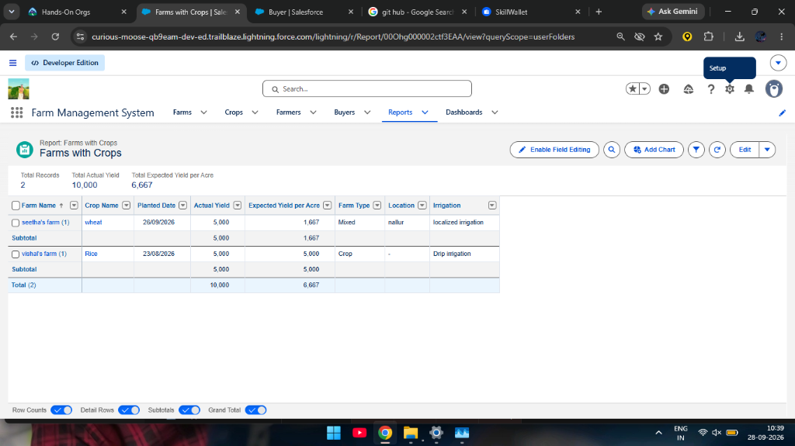
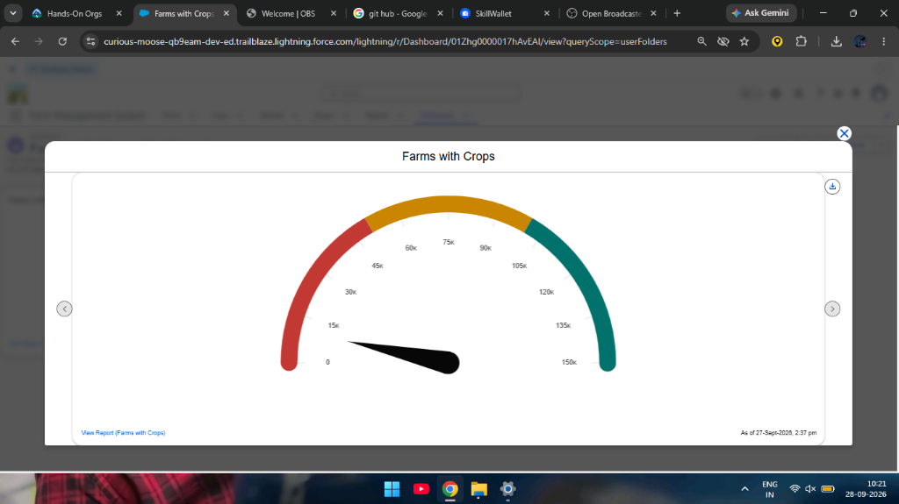

# FARM MANAGEMENT SYSTEM

### Salesforce Capstone Project — Final Report

---

## User Story

As a farmer, farm manager, or system administrator, I need a single, centralized platform built on Salesforce where I can record and keep track of everything related to my farms — the land details, the crops being grown, the farmers working on those farms, and the buyers purchasing the produce. Right now, most of this information lives in scattered notebooks, Excel files, or just in people's heads, and that leads to mistakes, lost records, and slow decision-making.

What I want is a system that makes it easy to enter and update farm details, log crop production data, and keep buyer transaction records — all through a clean, user-friendly interface that also catches errors before they get saved. On top of that, I want to be able to pull up reports and dashboards in real time so I can actually see how productive each farm is, which crops are performing well, and where improvements are needed. The system should also have proper role-based access so that not everyone can see or edit everything — sensitive data should stay protected, while still allowing everyone on the team to collaborate smoothly.

In short, this system should cut down on paperwork, reduce human errors, speed things up, and ultimately help us make smarter, data-driven decisions about how we manage our agricultural operations.

---

## 1. Introduction

### 1.1 Project Overview

The Farm Management System (FMS) is a Salesforce-based application that I built as part of my capstone project. The core idea is pretty straightforward — take the messy, manual process of managing agricultural data and turn it into something digital, organized, and actually useful. The application handles data related to farms, crops, farmers, and buyers, and ties everything together with reports and dashboards that provide real-time insights. Instead of flipping through paper registers or juggling multiple spreadsheets, a farmer or manager can just log in, enter or look up information, and get a clear picture of what is happening across their operations.

### 1.2 Purpose

The main goals behind building this project were to:

- **Digitize agricultural data management** — moving away from paper-based and Excel-based record keeping to a proper cloud system.
- **Improve data accuracy and accessibility** — making sure the right information is always up to date and available to the people who need it.
- **Automate record handling** — using validation rules and relationships to reduce manual effort and prevent bad data from getting in.
- **Enable real-time monitoring** — through reports and dashboards that refresh with live data.
- **Support data-driven farming decisions** — giving managers and farmers actual numbers and trends to base their choices on, instead of guesswork.
- **Enhance productivity and transparency** — by keeping everything in one place where it can be tracked and audited.

---

## 2. Ideation Phase

### 2.1 Problem Statement

Before building anything, I spent time understanding the real problems that different users face when it comes to managing farm-related data. I used a Customer Problem Statement approach to break this down by user type:

| # | Customer | Trying To | But | Because | Feeling |
|---|----------|-----------|-----|---------|---------|
| PS-1 | Farmer | Maintain farm and crop records | Data is often incomplete or incorrect | Records are kept manually in registers | Frustrated and confused |
| PS-2 | Farm Manager | Monitor farm productivity and sales | Reports are delayed and inaccurate | Data is scattered across files and sheets | Stressed and inefficient |
| PS-3 | Buyer | Access crop availability and pricing | Information is not updated regularly | There is no centralized digital system | Uncertain and dissatisfied |
| PS-4 | System Admin | Manage user access and system security | Unauthorized access may occur | Access control is handled manually | Concerned and insecure |

The pattern across all four user types was clear: everyone was dealing with fragmented, unreliable data, and none of them had access to a single source of truth. The farmer struggles with incomplete records because everything is scribbled in notebooks. The manager cannot produce timely reports because the underlying data is all over the place. The buyer has no way to check crop availability without calling someone. And the admin has no proper mechanism to control who accesses what. These are the problems this project was designed to solve.

### 2.2 Empathy Map

To get a deeper understanding of what our target users go through on a daily basis, I put together an empathy map covering farmers, farm managers, buyers, and system administrators.

**What they Think & Feel:**
These users are constantly worried about whether their data is accurate and up to date. Farmers think about whether they have recorded everything properly. Managers feel the pressure of needing timely information to make decisions. There is a general sense of anxiety about data loss and not having the right numbers when they are needed.

**What they Hear:**
They hear feedback from agricultural officers about the importance of maintaining proper records. They hear from peers about technology solutions being used in other places. Managers hear complaints from higher-ups about delays in reporting.

**What they See:**
Their current reality involves paper registers, cluttered spreadsheets, and hand-written logs. There is no unified system — just a collection of disconnected files and folders that different people maintain in their own way.

**What they Say & Do:**
They manually enter records into registers or Excel. They call each other on the phone to share information. They spend hours compiling reports by hand. They repeat the same data entry across different documents.

**Pain Points:**
Data loss when registers get damaged, duplicate entries, calculation errors, time wasted on manual compilation, delayed reports, and unauthorized people accessing sensitive information.

**What they Gain from a Solution:**
Automation of repetitive tasks, faster and more accurate reporting, a single platform for all data, proper access controls, and the confidence that comes from knowing the data is reliable.

### 2.3 Brainstorming

During the ideation phase, I considered several possible approaches:

- **Manual farm records** — the existing method, clearly insufficient.
- **Excel-based management** — slightly better but still prone to errors, version conflicts, and lacks real-time collaboration.
- **Web-based custom system** — powerful but would require significant development time and ongoing maintenance.
- **Mobile farm app** — useful for on-the-go access but would need backend infrastructure to be built from scratch.
- **Salesforce-based FMS** — provides a ready-made platform with built-in security, reporting, dashboards, and a flexible data model.

**Selected Idea:** I went with the Salesforce-based approach. It gave me the most functionality out of the box — custom objects for data modeling, Lightning UI for a clean interface, built-in reports and dashboards, and enterprise-grade security with profiles, roles, and sharing rules. This meant I could focus on designing the solution rather than building infrastructure from the ground up.

---

## 3. Requirement Analysis Phase

### 3.1 Customer Journey Map

I mapped out the typical journey a user would take through the system:

1. **Login** — User authenticates into the Salesforce org.
2. **Access Farm Management App** — User opens the FMS Lightning App from the App Launcher.
3. **Enter Farm and Crop Data** — User navigates to the relevant tabs and creates or updates records.
4. **Register Farmers and Buyers** — User adds farmer and buyer information with proper details.
5. **Generate Reports** — User runs reports to see aggregated data across farms and crops.
6. **Analyze Results** — User views dashboards for visual insights and trend analysis.
7. **Decision Making** — Based on the data, the user makes informed decisions about farm operations.

### 3.2 Solution Requirements

#### Functional Requirements

| FR No. | Requirement |
|--------|-------------|
| FR-1 | User Authentication |
| FR-2 | Farm, Crop, Farmer, and Buyer Management |
| FR-3 | Data Entry and Validation |
| FR-4 | Relationship Mapping between Objects |
| FR-5 | Report Generation |
| FR-6 | Dashboard Visualization |
| FR-7 | User Role Management |

#### Non-Functional Requirements

| NFR | Description | Example |
|-----|-------------|---------|
| Usability | Easy-to-use interface | Simple Lightning UI navigation |
| Security | Data protection mechanisms | Profiles, Roles, and Sharing Rules |
| Reliability | No data loss | Cloud-based backup and storage |
| Performance | Fast data access | Reports generated in under 3 seconds |
| Availability | 24/7 system access | Cloud hosting on Salesforce platform |
| Scalability | Handles growth | Supports additional farms, users, and regions |

### 3.3 Data Flow

The data flows through the system as follows:

**User → Salesforce Lightning UI → Custom Objects (Farm, Crop, Farmer, Buyer) → Validation Rules → Relationships → Reports → Dashboards**

Users interact with the Lightning interface, which feeds data into the custom objects. Validation rules ensure data integrity at the point of entry. Relationships connect related records (e.g., a Crop belongs to a Farm, a Farm is linked to a Farmer). Reports pull this data into structured views, and dashboards present it visually.

### 3.4 Technology Stack

| Layer | Technology |
|-------|------------|
| Frontend | Salesforce Lightning UI |
| Backend | Salesforce Platform |
| Database | Salesforce Cloud (Custom Objects) |
| Automation | Validation Rules, Field Dependencies |
| Analytics | Reports & Dashboards |

---

## 4. Project Design Phase

### 4.1 Problem–Solution Fit

The FMS directly addresses the problems identified in the ideation phase. Manual record-keeping is replaced with structured digital data entry in Salesforce. Cloud storage eliminates the risk of data loss from damaged registers. Interactive dashboards replace hand-compiled spreadsheets for analysis. Real-time reports remove the delays that managers previously faced. And role-based access with sharing rules solves the security concerns that administrators had. Each major pain point maps to a specific feature in the system.

### 4.2 Proposed Solution

| Parameter | Description |
|-----------|-------------|
| Problem | Manual maintenance of farm, crop, farmer, and buyer records leading to errors, data loss, and reporting delays. |
| Solution | A Salesforce-based Farm Management System with centralized data storage, structured relationships, and automation. |
| Innovation | Automated data entry validation, cloud storage, formula fields for yield calculations, and real-time reporting dashboards. |
| Impact | Improved data accuracy, faster reporting, and better decision-making for farmers and managers. |
| Business Model | Digital farm management and agricultural data services platform. |
| Scalability | Supports multiple farms, users, and regions through Salesforce's cloud-based infrastructure. |

### 4.3 Solution Architecture

The system is organized into four layers:

1. **Presentation Layer** — Salesforce Lightning UI provides the user interface with custom tabs and the Farm Management System Lightning App.
2. **Application Layer** — Validation rules enforce data integrity; field dependencies (e.g., State → District → Village) ensure consistent entries; relationships connect objects logically.
3. **Data Layer** — Four custom objects (Farm\_\_c, Crop\_\_c, Farmer\_\_c, Buyer\_\_c) store the core data, each with their own custom fields.
4. **Analytics Layer** — Reports aggregate data across objects, and dashboards visualize it using charts like gauges, bar charts, and tables.

---

## 5. Project Planning & Scheduling

### 5.1 Project Planning

The project was developed iteratively across multiple sprints. The major tasks completed were:

- Created a Salesforce Developer Org
- Developed four custom objects (Farm, Crop, Farmer, Buyer)
- Configured custom tabs for each object
- Built a Lightning App called "Farm Management System"
- Created custom fields and set up relationships between objects
- Designed profiles and roles for access control
- Created users and configured sharing rules
- Developed reports and dashboards
- Conducted functional testing and reviews

### 5.2 Product Backlog & Sprint Schedule

| Sprint | Epic | User Story # | User Story / Task | Story Points | Priority | Team Member |
|--------|------|-------------|-------------------|-------------|----------|-------------|
| Sprint-1 | Developer Setup | USN-1 | As a system administrator, I want to create and configure a Salesforce developer account so that I can set up and deploy the Farm Management System. | 3 | High | Member1 |
| Sprint-2a | Data Modeling | USN-2 | As an admin, I want to create Farm, Crop, Farmer, and Buyer objects with proper relationships so that agricultural data is stored and managed efficiently. | 5 | High | Member2 |
| Sprint-2b | Data Modeling | USN-3 | As a staff member, I want tabs and a Lightning App for all farm modules so that I can easily navigate and perform daily operations. | 5 | High | Member3 |
| Sprint-3a | Automation | USN-4 | As a system, I want to validate farm and crop details such as dates, quantities, and mandatory fields so that incorrect or incomplete records are prevented. | 3 | High | Member4 |
| Sprint-3b | Automation | USN-5 | As a manager, I want automated flows for crop updates and buyer notifications so that farm operations are processed faster without manual intervention. | 3 | High | Member4 |
| Sprint-4 | Security | USN-6 | As an administrator, I want role-based access control for farmers, managers, and buyers so that sensitive farm and transaction data is secure. | 5 | High | Member2 |
| Sprint-5 | Reports | USN-7 | As a farm manager, I want reports showing crop yield, sales, and buyer transactions so that I can monitor farm performance and make informed decisions. | 4 | High | Member3 |
| Sprint-6 | Dashboards | USN-8 | As a farm manager, I want dashboards showing crop productivity and operational statistics so that I can monitor performance visually. | 4 | Medium | Member4 |

### 5.3 Project Tracker

| Sprint | Total Story Points | Duration | Sprint Start Date | Sprint End Date (Planned) | Story Points Completed | Sprint Release Date (Actual) |
|--------|-------------------|----------|-------------------|--------------------------|----------------------|----------------------------|
| Sprint-1 | 20 | 6 Days | 24 Oct 2022 | 29 Oct 2022 | 20 | 29 Oct 2022 |
| Sprint-2 | 20 | 6 Days | 31 Oct 2022 | 05 Nov 2022 | 20 | 05 Nov 2022 |
| Sprint-3 | 20 | 6 Days | 07 Nov 2022 | 12 Nov 2022 | 20 | 12 Nov 2022 |
| Sprint-4 | 20 | 6 Days | 14 Nov 2022 | 19 Nov 2022 | 20 | 19 Nov 2022 |

---

## 6. Project Development Phase

### Project Description

The Farm Management System (FMS) in Salesforce is a complete solution designed to digitize and streamline how agricultural operations are handled. The application brings together data about farms, crops, farmers, and buyers into one unified platform. It empowers farmers and farm managers by giving them quick access to their data and providing meaningful insights through reports and dashboards — the kind of visibility that was simply not possible with manual record-keeping.

---

### Milestone 1 — Salesforce Developer Org Setup

**What is Salesforce?**

Salesforce is a cloud-based platform that lets you manage relationships with customers, collaborate with team members, and store data securely — all from anywhere with an internet connection. For this project, I used a Salesforce Developer Edition org, which provides all the features and licenses needed to build and test applications at no cost.

**What was done:**

I signed up for a Developer org at developer.salesforce.com, verified my account via email, and set up my password. This org became the environment where the entire Farm Management System was built and configured.

---

### Milestone 2 — Custom Objects

**What is an Object?**

In Salesforce, an object is essentially a database table. It contains fields (which are like columns) and records (which are like rows). Custom objects let you store data that is specific to your application.

**What was built:**

I created four custom objects to represent the core entities in the farm management domain:

| # | Object Label | API Name | Purpose |
|---|-------------|----------|---------|
| 1 | Farm | Farm\_\_c | Stores farm details like name, type, soil quality, irrigation, location, and size |
| 2 | Crop | Crop\_\_c | Stores crop information including planting dates, yield data, and expected yield calculations |
| 3 | Farmer | Farmer\_\_c | Stores farmer personal and contact details including state, district, and village |
| 4 | Buyer | Buyer\_\_c | Stores buyer information including contact, email, address, and buyer type |

Each object was configured with Allow Reports and Allow Search enabled, and the deployment status was set to Deployed. Notes and Attachments were added to the default page layouts.

**Object Manager — Custom Objects Overview:**

The screenshots below show the Object Manager listing all four custom objects (Crop\_\_c, Buyer\_\_c, Farm\_\_c, and Farmer\_\_c), as well as the individual detail pages for each object confirming their configuration.

**Individual Object Detail Pages:**

---

### Milestone 3 — Custom Tabs

**What are Tabs?**

Tabs in Salesforce serve as navigation elements that give users quick access to the data within each object. They appear in the navigation bar of a Lightning App and let users view, create, and manage records at a glance.

**What was built:**

I created a custom tab for each of the four custom objects — Farm, Crop, Farmer, and Buyer. Each tab was assigned an appropriate icon and configured with default visibility settings so that they show up in the app's navigation bar.

The screenshot below shows the Farm Management System app with all custom tabs (Farms, Crops, Farmers, Buyers, Reports, Dashboards) visible in the top navigation bar:

---

### Milestone 4 — Lightning App

**What is a Lightning App?**

A Lightning App in Salesforce is a collection of tabs grouped together to function as a unified application. It has a name, a logo, and a specific set of tabs that define its scope.

**What was built:**

I created a Lightning App called **"Farm Management System"** using the App Manager in Salesforce Setup. The app includes the following tabs in its navigation: Farms, Crops, Farmers, Buyers, Reports, and Dashboards. The System Administrator profile was assigned access to this app.

When a user opens the App Launcher and searches for "Farm Management System," they can see all the relevant tabs organized together — making it easy to navigate between different modules of the application without having to hunt for things.

The screenshot below shows the app in action with the Farms tab selected, displaying existing farm records (vishal's farm and seetha's farm):

---

### Milestone 5 — Fields and Relationships

**What are Fields?**

Fields in Salesforce represent individual data points within an object — similar to columns in a database table. Each field has a specific data type (text, picklist, date, currency, formula, etc.) that determines what kind of data it can hold.

**What was built:**

I created multiple custom fields across all four objects. Here is a summary of the key fields:

**Farm Object Fields:**
- **Farm Type** (Picklist) — Values: Crop, Livestock, Mixed
- **Soil Quality** (Picklist) — Values: Organic, Cover Crops, Composting
- **Irrigation** (Picklist) — Values: Sprinkler Irrigation, Drip Irrigation, Localized Irrigation
- **Location** (Text)
- **Size** (Text)
- **Farmer** (Master-Detail Relationship to Farmer\_\_c)

**Crop Object Fields:**
- **Crop Name** (Text)
- **Planting Date** (Date)
- **Harvest Date** (Date)
- **Farm** (Lookup Relationship to Farm\_\_c)
- **Actual Yield** (Currency)
- **Total Acres Harvested** (Number, max length 20)
- **Expected Yield per Acre** (Formula — Currency) — Calculates: `Actual_Yield__c / Total_Acres_Harvested__c`

**Farmer Object Fields:**
- **Contact Number** (Phone)
- **State** (Picklist) — Values: Telangana, Andhra Pradesh, Tamil Nadu
- **District** (Picklist, Dependent on State)
- **Village** (Picklist, Dependent on District)

A **field dependency** was set up on the Farmer object: selecting a State filters the available Districts, and selecting a District filters the available Villages. For example, choosing "Telangana" would show "Yadadri Bhongir" as a district option.

**Buyer Object Fields:**
- **Contact** (Phone)
- **Email** (Email)
- **Address** (Text Area)
- **Buyer Type** (Picklist) — Values: Wholesale, Retail

The screenshot below shows the "New Farm" record creation form, displaying all the custom fields (Farm Name, Farm Type, Soil Quality, Irrigation, Location, Size, and the Farmer lookup) that were configured on the Farm object:

---

### Milestone 6 — Profiles

**What is a Profile?**

A profile in Salesforce is a collection of settings and permissions that defines what a user can do within the platform. It controls object permissions, field-level security, tab visibility, app access, login hours, and much more. Each user is assigned exactly one profile.

**What was built:**

I created two custom profiles by cloning the Standard User profile:

1. **Sales Department** — For users handling buyer-related operations.
2. **Farm Manager** — For users overseeing farm operations, crop management, and reporting.

These profiles were customized with appropriate permissions to ensure that each user type has access only to the objects and features relevant to their role.

---

### Milestone 7 — Roles

**What are Roles?**

Roles in Salesforce define the reporting hierarchy within an organization and determine which records a user can access based on their position in that hierarchy. Users with higher roles can generally see data owned by users in roles below them.

**What was built:**

I configured the role hierarchy by adding a **"Farm Manager"** role under the CEO role. This hierarchy ensures that users at the Farm Manager level have appropriate data visibility, while the overall hierarchy supports the organizational structure of a typical farm operation.

---

### Milestone 8 — Users

**What is a User?**

A user in Salesforce represents anyone who logs into the system — employees like sales reps, managers, farm workers, or IT staff. Each user has an account with settings that control their access to features and data.

**What was built:**

I created two users in the Developer org:

1. **Farm Manager** — Assigned the Farm Manager role and the Farm Manager profile. Licensed as a Standard Platform User.
2. **Sales Department** — Assigned the Sales Manager profile with appropriate permissions for handling buyer data.

> **Note:** The Salesforce Developer Edition limits the number of active Salesforce licenses to 2. If additional users are needed, existing users may need to be deactivated or their license type changed.

---

### Milestone 9 — Sharing Rules

**What are Sharing Rules?**

Sharing rules extend data access beyond what the Organization-Wide Defaults (OWD) provide. They are used when the OWD is set to Private or Public Read-Only, and you need specific users or groups to have additional access to certain records. Sharing rules can be owner-based or criteria-based.

**What was built:**

I created two sharing rules:

1. **Crop sharing rule** — A criteria-based sharing rule that shares Crop records with the Farm Manager role, granting Read/Write access. The rule triggers based on specific field criteria on the Crop object.

2. **Buyer sharing rule** — Shares Buyer records with the Sales Department role, granting Read/Write access. This ensures that sales personnel can view and modify buyer information as needed.

---

### Milestone 10 — Data Entry (User Adoption)

To test the system end-to-end, I created sample records across all four objects by navigating to the Farm Management System app through the App Launcher. I clicked on each tab (Farmers, Farms, Crops, Buyers), hit "New," filled in the required details, and saved the records.

This step verified that all the fields, picklists, field dependencies, relationships, and validation rules were working correctly in a real usage scenario.

---

### Milestone 11 — Reports

**What are Reports?**

Reports in Salesforce display a list of records that match specific criteria. They are organized in rows and columns, and can be filtered, grouped, and enhanced with charts. Reports are stored in folders that can be made public, private, or shared with specific users.

**What was built:**

I created a report called **"Farms with Crops"** that pulls data from the Farm and Crop objects. The report displays the following columns:

- Farm Name
- Crop Name
- Planted Date
- Actual Yield
- Expected Yield per Acre
- Farm Type
- Location
- Irrigation

The report is grouped by Farm Name and shows subtotals and grand totals for Actual Yield and Expected Yield per Acre. It was saved to a public folder so that authorized users can access it.

As shown in the screenshot, the report displays data for two farms — seetha's farm (wheat, Mixed type, localized irrigation) and vishal's farm (Rice, Crop type, Drip irrigation) — with a total Actual Yield of 10,000 and total Expected Yield per Acre of 6,667:

---

### Milestone 12 — Dashboards

**What are Dashboards?**

Dashboards in Salesforce provide a visual summary of data from one or more reports. They combine information into charts, graphs, gauges, and tables — giving users a quick, high-level view of key metrics without needing to dig through individual reports. Dashboards are particularly useful for managers who need to make quick decisions based on current data.

**What was built:**

I created a dashboard called **"Farms with Crops"** that includes a **Gauge chart** component. This gauge visualizes the aggregated crop yield data from the "Farms with Crops" report, making it easy to see at a glance how production is tracking against expectations.

The dashboard was saved and is accessible from the Dashboards tab within the Farm Management System Lightning App.

---

## 7. Functional & Performance Testing

During the testing phase, I went through the system systematically and captured screenshots to verify that everything was working as expected. The following areas were tested:

- **Record Creation** — Successfully created Farm, Crop, Farmer, and Buyer records with all custom fields.
- **Field Validation** — Confirmed that required fields enforce proper input and picklists display the correct values.
- **Relationship Integrity** — Verified that Master-Detail (Farm to Farmer) and Lookup (Crop to Farm) relationships link records correctly.
- **Field Dependencies** — Tested that State → District → Village dependencies filter values appropriately on the Farmer object.
- **Profile & Role Access** — Logged in as different users to confirm that each profile and role restricts or grants access as configured.
- **Sharing Rules** — Verified that sharing rules correctly extend data access to the intended roles.
- **Reports & Dashboards** — Confirmed that reports display accurate aggregated data and dashboards render charts correctly.

Performance testing confirmed that the system responds smoothly — reports load quickly, record creation is instant, and dashboard visualizations render without noticeable delay.

---

## 8. Advantages & Disadvantages

### Advantages

- **Centralized data system** — All farm, crop, farmer, and buyer information lives in one place.
- **Reduced paperwork** — No more handwritten registers or manual data compilation.
- **Improved accuracy** — Validation rules and structured fields prevent bad data from entering the system.
- **Better monitoring** — Managers can track farm operations in real time through reports and dashboards.
- **Real-time analytics** — Dashboards update automatically, providing up-to-date insights at any time.

### Disadvantages

- **Internet dependency** — Since Salesforce is a cloud platform, users need a stable internet connection to access the system.
- **License limitations** — The Developer Edition has restrictions on the number of active users and certain enterprise features.
- **Limited offline access** — There is no built-in offline mode for data entry when connectivity is unavailable.

---

## 9. Conclusion

Looking back at this project, I think the Farm Management System turned out to be a solid demonstration of what Salesforce can do when applied to a real-world domain like agriculture. What started as a fairly straightforward capstone assignment ended up teaching me a lot about how to think through a problem from the user's perspective, design a data model that actually makes sense, and then bring it all together with the tools Salesforce provides.

The system does what it was meant to do — it replaces the fragmented, error-prone manual processes with a clean, centralized digital platform. Farmers can enter their data without worrying about it getting lost. Managers can pull up a dashboard and see exactly how things are going without waiting for someone to compile a spreadsheet. Buyers and sales teams have the information they need, when they need it. And the admin can rest easier knowing that access controls are handled by the system rather than by trust alone.

Of course, it is not a perfect system. There are things I would do differently if I had more time — like adding more complex automation with Flows, building custom Lightning Web Components for a richer UI, or integrating external data sources like weather APIs. But as a capstone project, it covers all the major Salesforce concepts — objects, fields, relationships, profiles, roles, sharing rules, reports, and dashboards — and applies them to a real, practical use case.

I am genuinely glad I chose this project. It gave me hands-on experience with the Salesforce platform that goes beyond what you learn just from Trailhead modules, and I feel much more confident about working with Salesforce in a professional setting going forward.

---

## 10. Future Scope

There is plenty of room to extend this system beyond its current state:

- **Mobile application integration** — Building a Salesforce Mobile-optimized version for field use.
- **AI-based crop prediction** — Using Einstein Analytics or external ML models to predict crop yields based on historical data.
- **Weather data integration** — Connecting to weather APIs to factor in rainfall, temperature, and seasonal patterns.
- **IoT sensor connectivity** — Integrating soil moisture sensors, temperature monitors, and other IoT devices for automated data collection.
- **Government scheme integration** — Linking to government agricultural databases to help farmers access subsidies and schemes they qualify for.
- **Market price forecasting** — Incorporating real-time market data to help farmers and buyers make better pricing decisions.

---

## 11. Appendix

- **Source Code:** Salesforce Configuration and Metadata (Custom Objects, Fields, Profiles, Roles, Sharing Rules)
- **Dataset:** Sample Farm, Crop, Farmer, and Buyer Records created during testing
- **Tools Used:** Salesforce Developer Edition Org, Salesforce Lightning Experience

---

*Thank You*
